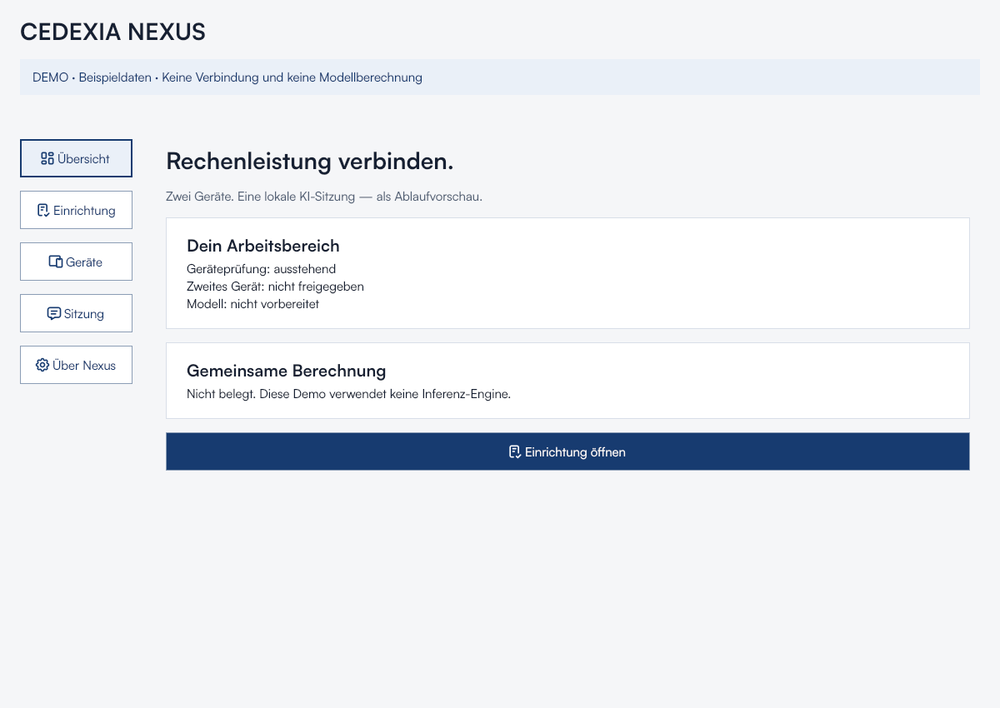
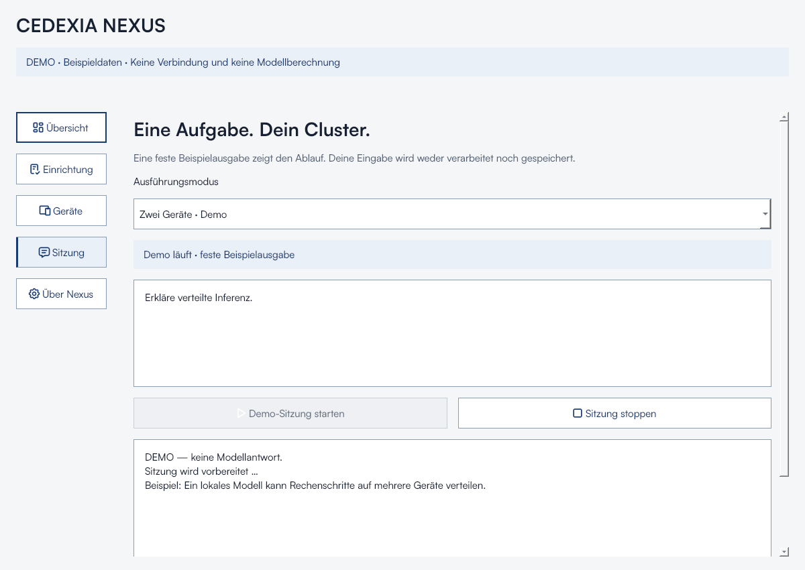

# Desktop-App · Lokale Modelle und LAN-Verbindung

Geführte Installer für Mac und Windows installieren App und Laufzeiten ohne
Modellgewichte. [Download, Installation und Updates](installation.md).

## Projekt- und Chatoberfläche

NX-054 und NX-055 öffnen die App mit einer einklappbaren Sidebar, Projekten und
Chats. Der Composer unten enthält die Modellauswahl, MCPs, Skills, Diktateinstieg,
Senden und Stoppen. GGUF-Dateien werden unter **Einstellungen → Modelle** hinzugefügt.
Nachrichten werden pro Chat in einer SQLite-Datenbank im lokalen
App-Datenverzeichnis gespeichert. Beim Neustart öffnet sich der zuletzt
angelegte Chat. Chats lassen sich nach Bestätigung löschen. Die Datenbank ist
unverschlüsselt und unterliegt dem Zugriffsschutz des Benutzerkontos.

Der lokale Chat übergibt Nutzernachrichten und Antworttext an die Runtime.
Das Gesamtlimit von 12000 Zeichen umfasst Verlauf, Skills und MCP-Kontext.
Bei Überschreitung kann der Nutzer den Entwurf kürzen oder einen neuen Chat
beginnen. Die Runtime prüft das tatsächliche Kontextfenster. Meldet sie eine
gekürzte Eingabe, bricht die App den Lauf ab und übernimmt diese Eingabe
bei Folgeläufen nicht in den Modellkontext. Bei vollem Kontext endet die
Generierung ohne Kontextverschiebung. Die vollständige Budgetvorschau vor dem
Laden des Modells wird in NX-047 behandelt.

Mit NX-048 haben Nutzernachrichten und Antworten eigene Bereiche. Denktext
steht standardmäßig eingeklappt unter **Denktext anzeigen**. Die Schaltfläche
ist per Tab und Leertaste bedienbar. Die App erkennt explizite
`<think>…</think>`-Tags sowie den getesteten Qwen-Chat-Template-Fall, bei dem
das öffnende Tag bereits im Prompt steht. Fehlt das Ende eines erkannten
Denkabschnitts, bleibt dieser im Denktext. Bei unbekanntem Format gilt Ausgabe
ohne Tags als Antworttext. Bereits gespeicherte Antworten werden beim Öffnen
auf bekannte Marker geprüft.

Antwort und Denktext werden getrennt in der lokalen Chatdatenbank gespeichert.
Nur Antworttext gelangt in nachfolgende Modellprompts und über **Antwort
kopieren** in die Zwischenablage. **Code kopieren** übernimmt den Inhalt des
jeweiligen Markdown-Codeblocks inklusive Zeilenumbrüchen. Markdown rendert ohne
rohes HTML und Skriptausführung. Externe Links öffnen nach Bestätigung.
Gestoppte, fehlgeschlagene und möglicherweise abgeschnittene Läufe zeigen
einen Hinweis an der betroffenen Antwort.

**Einstellungen** öffnet ein separates Fenster mit Schriftgröße, hellem/dunklem
Erscheinungsbild, Kontext- und Ausgabetokens, Reasoning-Anforderung, lokalen
Skills, MCP-Verbindungen und Geräteverwaltung. Modellparameter gelten ab dem nächsten
Modellstart und sind derzeit global. Skills und MCP-Freigaben gelten pro Chat.
Der Diktatbutton erklärt den Einstieg in die Systemdiktierfunktion. Eine eigene
Audioaufnahme oder Transkriptionsruntime ist noch offen.

Im Gerätemodus öffnet **Gerät hinzufügen** den vollständigen Kopplungsdialog.
Nach der Verbindung erscheint wieder das Chatfenster. Senden im Gerätemodus
wartet auf die gemeinsame Inferenz aus NX-011. Die bisherigen Modellprüfungen
und Demoansichten bleiben unter den erweiterten Einstellungen erreichbar.
Der Zwei-Fenster-Kopplungstest und die bisherigen Runtime-Tests bleiben aktiv.

Die UI verwendet Python/PySide6. Übersicht, Einrichtung und Demo-Sitzung zeigen
simulierte Abläufe. Die getrennte Ansicht **Lokales Modell** führt auf dem Mac
offline Textinferenz aus. Für Windows
liefert NX-052 ein Paket mit derselben Ansicht und CUDA als Backend.
Beide Apps merken sich die hinzugefügten Modellpfade und die letzte Auswahl.
Prompts und Antworten bleiben im Speicher.

## Skills und MCPs (NX-057)

Unter **Einstellungen → Skills** können UTF-8-Markdown-Dateien (`.md`, auch
`SKILL.md`, bis 128 KiB) importiert, neu erstellt, bearbeitet und gelöscht werden.
Speichern übernimmt die Änderungen; der Import kopiert den Inhalt in die lokale
Chatdatenbank und verändert die Quelldatei nicht. Unter dem Chat aktiviert
**Skills** die gewünschten Einträge für diesen Chat. Ihr Markdown wird jeder
folgenden Nachricht als Anweisung vorangestellt. Alte lokale Anweisungen werden
einmalig als Skill übernommen und für bereits vorhandene Chats aktiviert.
Neue Chats beginnen ohne aktive Skills. Frontmatter bleibt erhalten; verlinkte
Dateien und ausführbare Skripte aus Skillpaketen werden nicht ausgeführt.

Unter **Einstellungen → MCPs** eine Verbindung benennen, konfigurieren und speichern:

- **stdio:** vollständiger Pfad zu einem bereits installierten Programm wie Python
  oder Node und Argumente als JSON-Array. Kein Shellkommando, kein automatischer
  Download oder Paketinstallationsschritt; Windows-Batchdateien werden nicht gestartet.
- **http:** vollständige Streamable-HTTP-MCP-Adresse über HTTPS. HTTP ist nur für
  Loopback-Server zulässig. Ein optionaler Bearer-Token bleibt im Arbeitsspeicher
  und wird beim Trennen gelöscht. OAuth-Anmeldung und ältere SSE-Transporte sind
  noch nicht unterstützt. Zugangsdaten gehören nicht in URL oder Argumente.

**Verbinden** startet die lokale stdio-Sitzung beziehungsweise verbindet den
HTTP-Client und lädt die Werkzeugliste. Unter dem Chat **MCPs** den Server für
diesen Chat aktivieren. **Werkzeuge aufrufen** öffnet die Liste mit Beschreibung,
JSON-Schema und Argumenteingabe. Jeder Aufruf erfolgt ausdrücklich per Button;
das lokale Modell startet keine selbstständige Werkzeugschleife. Nur eine
MCP-Sitzung ist gleichzeitig verbunden. Deaktivieren verhindert neue Aufrufe,
**Trennen** beendet auch die Sitzung. Bereits gestartete Aktionen können beim
Server schon ausgeführt worden sein und werden durch Trennen nicht zurückgenommen.

Ein Ergebnis kann bearbeitet und mit **Ergebnis als Kontext in diesen Chat
übernehmen** für die nächste Nachricht bereitgestellt werden. Ergebnisse aus
anderen Chats oder deaktivierten Verbindungen werden nicht übernommen. Die
letzte Übernahme ersetzt den vorgemerkten Kontext; Chatwechsel verwirft ihn.
Das Gesamtlimit von 12000 Zeichen umfasst auch Skills und Werkzeugkontext.
MCP-Ergebnisse sind externe Daten; nur bewusst ausgewählte Inhalte übernehmen.
Serverprogramme und Werkzeuge laufen mit den Rechten des Benutzerkontos.
Gespeicherte Konfigurationen und Markdown liegen unverschlüsselt in der lokalen
Chatdatenbank. Es wird kein MCP-Server durch Cedexia Nexus veröffentlicht.

Validierung auf macOS: reale stdio- und Loopback-HTTP-Testserver mit Discovery,
Toolaufruf und Sitzungsende; Markdown-Import, Editor, Migration, Persistenz,
Chatfreigaben und Übergabe an den Inferenzprozess. Die Tests benötigen keine
Modellgewichte und belegen keine Modellqualität oder verteilte Inferenz.

## Geräte im LAN verbinden

1. Auf beiden Geräten Cedexia Nexus mit NX-053 öffnen. Auf dem Mac einmalig
   `.venv/bin/python -m pip install -r requirements-ui.txt` ausführen und
   die App wie gewohnt starten. Auf Windows gehört die TLS-Bibliothek zum
   vollständigen [EXE-Paket](windows-app.md).
2. Auf dem Mac **Geräte verbinden** öffnen, die LAN-Schnittstelle auswählen,
   **Einladung erstellen** klicken und den Code kopieren. Den Code vertraulich
   an das beitretende Gerät weitergeben. Er gilt fünf Minuten und für einen
   Beitritt. Windows kann die Einladung ebenfalls erstellen.
3. Auf dem zweiten Gerät unter **Geräte verbinden** den Code einfügen und
   **Beitreten** klicken. Bei einer Betriebssystemabfrage nur den lokalen
   Netzwerkzugriff bzw. das private Netzwerk zulassen.
4. Die App prüft die in **Lokales Modell** ausgewählten Dateien im Hintergrund.
   Bei Split-GGUFs den ersten Teil auswählen und alle Teile im selben Ordner
   belassen. Die Prüfung liest jede Datei vollständig. Je nach Größe und
   Datenträger kann sie mehrere Minuten dauern.
5. Bei unterschiedlichen oder fehlenden Gewichten kann das einladende Gerät
   **Downloadhinweis senden**. Für das per SHA-256 erkannte Referenz-Qwen füllt
   die App die gepinnte Hugging-Face-Adresse aus. Für andere Modelle die
   öffentliche HTTPS-Adresse der genauen Datei oder des Split-Satzes einfügen.
   Das zweite Gerät öffnet den Link auf Klick im Browser, lädt die Gewichte
   dort und wählt sie in der App aus. **Gewichte erneut prüfen** erkennt eine
   am selben Pfad ersetzte Datei.
6. **Trennen** oder das Fenster schließen. Die Sitzung endet auch nach
   zwei Stunden.

Der Abgleich vergleicht SHA-256, Größe und Anzahl der Dateien. Unterschiedliche
Namen sind bei identischem Inhalt möglich. Der Status beschreibt die geprüften
Dateien zum Zeitpunkt des Abgleichs. Die Geräteansicht startet keinen
Inferenzauftrag. Gemeinsame Modellberechnung wird separat in NX-011 geprüft.
Die Verbindung verwendet IPv4 im selben privaten LAN. VPNs, isolierte
Gastnetze und Host-Firewalls können den Zugriff verhindern.

## Lokales Modell in der UI testen

Unter Windows x64 steht der [EXE-Paketpfad](windows-app.md) mit CUDA und
Dateiauswahl zur Abnahme auf dem Ziel-PC bereit. Die folgende Anleitung
beschreibt den bereits geprüften Mac-Pfad.

Auf dem in NX-005 eingerichteten Mac `.venv/bin/python -m nexus_ui` starten.
Die App öffnet „Lokales Modell“. Über **GGUF hinzufügen …** vorhandene Dateien
in die Liste aufnehmen und das gewünschte Modell wählen. Eine Aufgabe eingeben
und **Lokal starten** wählen. Die App prüft den GGUF-Dateikopf und übergibt die
Datei an llama.cpp. Die Antwort erscheint schrittweise. **Stoppen** funktioniert
auch während der Prüfung und beim Laden. Schließen des Fensters beendet den
lokalen Prozess. Nach Abschluss oder Fehler ist ein manueller Neustart möglich.

Voraussetzungen: nativer Apple-Silicon-Mac, der [NX-005-Build](mac-metal.md) unter
`local/build/llama-metal/bin/llama-completion` und ein kompatibles GGUF-Textmodell,
das in den verfügbaren Speicher passt. Bei einem geteilten GGUF den ersten Teil
auswählen und alle Teile im selben Ordner belassen. **Eintrag entfernen** entfernt
nur den Pfad. Eine vorhandene Datei `models/Qwen3.8-27B-Q4_K_M.gguf` wird beim
ersten Start vorausgewählt. Installation und Download erfolgen manuell.

Grenzen seit NX-043: einzelne Aufgaben ohne Gesprächshistorie, 16384 Kontexttokens,
höchstens 12000 Eingabezeichen und 8192 Ausgabetokens. Zeichen sind keine Tokens:
Eingabe, Template und Ausgabe teilen sich das Kontextfenster, das je nach Text
schon vor 12000 Zeichen ausgeschöpft sein kann. Zeitlimit 1800 Sekunden für
Prüfung plus Modelllauf. Lange Antworten können abbrechen; Denktext zählt zum
Ausgabebudget. Denktext kann trotz
der Runtime-Option `--reasoning off` sichtbar bleiben. Keine erfundenen
Geschwindigkeits-/TTFT-Werte. Für wiederholbare Benchmarks gilt NX-007.

Beispiel: `Baue mir eine kleine HTML-Website für ein Restaurant. Liefere eine
vollständige kompakte HTML-Datei mit eingebettetem CSS, Speisekarte und Kontakt.`
Die Ausgabe ist weiterhin Klartext zum Kopieren; generierter Code wird nicht
ausgeführt. Nach einem Update die App neu starten, damit die neuen Grenzen gelten.

Technik: `nexus_ui/local_model.py` verwaltet jeweils einen asynchronen QProcess.
Erst GGUF-Kopfprüfung, dann direkte Runtime-Ausführung ohne Shell. Der Prompt wird
über stdin übergeben, nicht als Prozessargument oder temporäre Datei. Runtime-
Fehler werden in verständliche Meldungen übersetzt. Die App speichert keine Rohlogs.
Keine Prompt-/Antwortpersistenz, kein HTTP-/RPC-Server. Demo-Aktionen verändern
den lokalen Modellprozess nicht.

### NX-042-Nachweis vom 12.11.2026

39 lokale Tests bestanden: 25 Standardbibliothek, 6 Demo-Interaktionstests und
8 neue Qt-Prozesstests. Letztere verwenden echte kleine Kindprozesse ohne Modell
für Unicode-Streaming/stdin, fehlgeschlagene Hashprüfung, Stopp in beiden Phasen,
manuellen Neustart, Timeout, Start-/Runtimefehler und Fensterschließen. Rohfehler
werden nicht in die Oberfläche übernommen. Compileall und Whitespace geprüft.

Auf dem physischen Apple-M5-Mac mit macOS 27.2, Python 3.13.15 und PySide6 6.8.3
die native UI geöffnet und tatsächlich geprüft: Abbruch während SHA-Prüfung,
Abbruch beim Modellladen, Navigation während des Laufs, manueller Neustart und
echte Antwort `Hallo aus Nexus.`. Nach Abschluss kein aktiver Kindprozess.
Die fertige lokale Ansicht visuell geprüft; Satoshi fehlt auf diesem Mac,
Systemschrift-Fallback aktiv. Windows-/Linux-CI testet Prozesssteuerung mit
Testprozessen, keine dortige Inferenz. High-DPI/Screenreader-Abnahme bleibt NX-037.

### NX-043: größere Testaufgaben · 13.11.2026

Die festen Grenzen wurden auf 16384 Kontext-/8192 Ausgabetokens, 12000
Eingabezeichen und 1800 Sekunden für die UI erhöht. Der Terminalhelfer verwendet
dasselbe Tokenbudget. Es gibt weiterhin keine konfigurierbaren Modellparameter.

Ein erster Restaurant-Website-Test mit 4096 Kontext-/2048 Ausgabetokens endete
nach 342,7 Sekunden am Ausgabebudget, noch während des Denktexts/Entwurfs. Daher
war diese Zwischenkonfiguration für den Anwendungsfall nicht ausreichend.
Die Laufzeit ist eine Einzelbeobachtung einschließlich Hashprüfung und Laden,
kein reproduzierbarer Benchmark und keine zugesicherte Antwortzeit.

Der identische Prompt lief mit den endgültigen Grenzen 905,6 Sekunden und
lieferte 16156 Zeichen, bevor er über „Stoppen“ beendet wurde. Die Oberfläche
blieb navigierbar, danach war kein Kindprozess aktiv. Eine vollständige finale
HTML-Antwort wurde nicht erreicht: Die Ausgabe enthielt noch Denktext und
Entwürfe. Die höheren Grenzen und der Langlauf-Abbruch sind damit geprüft,
die vollständige Restaurant-Website-Abnahme bleibt offen (NX-043: Review).
Ein größeres Budget allein behebt das bekannte Reasoning-Verhalten nicht.

Synthetischer Testprompt: „Baue mir eine kleine HTML-Website für ein Restaurant.
Liefere eine vollständige kompakte HTML-Datei mit eingebettetem CSS, Speisekarte
und Kontakt. Verwende fiktive Inhalte und keine externen Ressourcen. Halte die
Datei unter 80 Zeilen.“ Kein generierter Code wurde ausgeführt.

39 Tests mit Qt auf macOS bestanden auch mit den endgültigen Grenzen;
Compileall, Shell-Syntax und Whitespace geprüft. Stopp, Timeout, Neustart und
Prozessbereinigung bleiben durch die bestehenden Interaktionstests abgedeckt.
Die aktualisierte Ansicht mit den neuen Hinweisen wurde visuell geprüft.

## Start

Python 3.11–3.13; Windows x64 oder macOS Apple Silicon als Zielplattformen.
Die Python-/Qt-Kombination muss auf beiden Zielgeräten noch abgenommen werden.

macOS/Linux:

```sh
python3 -m venv .venv
.venv/bin/python -m pip install -r requirements-ui.txt
.venv/bin/python -m nexus_ui
```

Windows PowerShell:

```powershell
py -3 -m venv .venv
.\.venv\Scripts\python.exe -m pip install -r requirements-ui.txt
.\.venv\Scripts\python.exe -m nexus_ui
```

Aus dem Repository-Root starten. Kein Build/Installer erforderlich. Native
Fensterrahmen bleiben erhalten. Alle Inhaltsseiten sind scrollbar.

## Satoshi lokal einrichten

Satoshi bei https://www.fontshare.com/fonts/satoshi selbst als ZIP herunterladen
und die beigefügte Lizenz lesen. Dann mit dem Python der virtuellen Umgebung:

```sh
python scripts/install_satoshi.py /pfad/zum/Satoshi.zip
```

Das Skript importiert ausschließlich die drei unveränderten OTFs Regular,
Medium und Bold in `nexus_ui/assets/fonts/`. Kein Netzwerkzugriff. Die Dateien
sind Git-ignoriert. Bei fehlenden Fonts zeigt die App einen sichtbaren Hinweis
und verwendet die Systemschrift.

Die geprüfte offizielle FFL 2.0 vom 17.08.2026 erlaubt persönliche/kommerzielle
Nutzung und Desktop-App-Einbettung (Abschnitt 01), untersagt jedoch die freie
Weiterverteilung der Fontdateien über Repositories (Abschnitt 02). Daher keine
OTFs im öffentlichen Git. Vor einer verteilten App-Paketierung die konkrete
Einbettung gegen diese Bedingungen prüfen. Keine Fontänderung oder Subsetting.
Prüfquelle: https://api.fontshare.com/v2/fonts/download/satoshi, 12.11.2026.
SHA-256 des geprüften Archivs:
`476fee84de48af8bbf1af339c728a6ea69c8f49c742c3e115fd4f8ffddf51add`.

## Icons und Drittanbieter

Tabler Icons Outline v3.35.0, Commit
`147130cd0e67a9cfc70538f8b3a14a48a695d90b`, lokal als SVG. Originale MIT-Lizenz
unter `nexus_ui/assets/icons/LICENSE`, Quellpfad und Einzeldatei-Hashes im
benachbarten `manifest.json`. In der App über „Über Nexus → Tabler-Lizenz“
abrufbar. Bei Paketierung Assets und Lizenz gemeinsam ausliefern.

PySide6/Qt wird als Entwicklungsabhängigkeit aus offiziellen Wheels installiert.
Für die spätere App-Verteilung LGPL-/Drittanbieterpflichten und verwendete
Module separat dokumentieren; diese Demo erstellt keinen Installer. Die
Projektlizenz bleibt offen.

## Bedienpfad der Demo

1. Einrichtung: Geräteprüfung und Modellprüfung simulieren.
2. Geräte: gegenseitige Freigabe simulieren; RAM-Limit als unwirksamen Entwurf ändern.
3. Sitzung: einen Modus wählen und eine Nachricht eingeben.
4. Demo starten; feste Ausgabe erscheint zeitgesteuert. Stopp und simulierter
   Speicherfehler beenden den Lauf. Eingaben bleiben für manuellen Neustart erhalten.
5. Im Dual-Modus während eines Laufs das zweite Gerät trennen: verständlicher
   Fehler, kein automatischer Neustart. Erneute Freigabe und manueller Start nötig.

Ressourcen sind pro Gerät getrennt. Kein gemeinsamer Speicherwert und keine
erfundenen Leistungsmetriken. Ein Solo-Lauf hängt nicht vom zweiten Gerät ab.

## Tests und Grenzen

```sh
python -m unittest discover -s tests -v
python -m compileall -q scripts tests nexus_ui
git diff --check
```

Qt-Tests laufen offscreen; ohne UI-Abhängigkeit werden ausschließlich diese
Tests übersprungen. Bootstrap-Tests bleiben unabhängig von Qt.
Die Plattformmatrix in CI prüft alle drei Betriebssysteme offscreen.
Physische Zielgeräte, Screenreader,
200-%-Textskalierung und High-DPI benötigen manuelle Abnahme. NX-037 erst nach
diesen Nachweisen abschließen.

## Testnachweis vom 12.11.2026

Linux x86_64, Python 3.12.14, PySide6 6.8.3, Qt-Offscreen-Plattform:
23 Tests bestanden (17 Bootstrap + 6 UI). Geprüft: Tastaturnavigation,
Startbedingungen einschließlich Peer-Freigabe, zeitgesteuerter Abschluss,
Stopp ohne Folgeausgabe, Speicherfehler, Peer-Abbruch mit manuellem Neustart
und SVG-Hashes/Rendering. Satoshi wurde aus den lokalen OTFs erfolgreich geladen.
Compileall und `git diff --check` erfolgreich. Ein Fontconfig-Cachehinweis der
Sandbox verhinderte weder Fontladen noch Rendering.

Die folgenden Screenshots stammen aus dem tatsächlichen Qt-Rendering unter
Linux; sie sind keine Windows-/Mac-Nachweise. Ticketstatus: Review,
vollständige Plattformabnahme offen.

Ergänzung vom 12.11.2026: Auf dem physischen Mac (Apple M5, arm64,
macOS 27.2, Python 3.13.15, PySide6 6.8.3) wurde die Demo als sichtbares
Cocoa-Fenster gestartet. Satoshi fehlt lokal; die App nutzt die Systemschrift.
Die vollständige Suite mit den neuen Inventur-/Integritätsprüfungen bestand
mit 31 Tests, davon 6 Qt-Interaktionstests offscreen. Dies ersetzt keine
manuelle High-DPI-, Screenreader- oder Windows-Abnahme.

Der erste [CI-Lauf](https://github.com/Ceda1998/cedexiaNexus/actions/runs/43292374820)
zeigte zwei konkrete Fehler: Windows wandelte SVG-Zeilenenden um und verletzte
damit die gepinnten Hashes; Linux fehlte `libEGL.so.1`. `.gitattributes` erzwingt
nun LF für die SVGs, der Linux-Desktopjob installiert `libegl1` und `libopengl0`.
Die strengen Icon-Hashes bleiben unverändert. Den Nachweis des korrigierten
Commits liefern die [GitHub Actions](https://github.com/Ceda1998/cedexiaNexus/actions).





## Roadmap-Prüfung

Für das Nutzerziel ist der technische Kern sinnvoll: NX-001/002/004,
NX-005/006, NX-007/008 und NX-003/009 führen zu NX-011/012. NX-037 liefert
die frühe Bedienoberfläche. Eine reine Client/Server-Chat-Verbindung reicht
für den geforderten gemeinsamen Rechennachweis nicht.

Linux-Docker, externe Community-Installation, B2B und Multi-Household sind
spätere Ausbaustufen. Für den lokalen Prototyp muss keine vollständige
Alpha-Plattform fertiggestellt sein. Sichere Live-Anbindung bleibt erforderlich,
ein eigener REST-Server ist für die Qt-Oberfläche jedoch kein Selbstzweck.
NX-010 (alternative Runtime) sollte nur bei Bedarf zum Engpass werden;
die bestehende NX-016-Abhängigkeit ist bei späterer Planung zu überprüfen.
Diese Desktop-Demo gehört zu NX-037; Inventur und Modellfestlegung sind
separat in NX-002 und NX-004 dokumentiert.
